# Visual review, 2026-10-26

Frontend run on `hook`. It continues the run on `message` that the provider
limit cut off at turn 56, which opened #554, committed this file as its
placeholder and rendered nothing. The item is the one that run took.

Board card `2d4370ee`, "Does display type balance as a house rule, or does the
dek's new rule stand alone?" The card asked for an eye rather than a
measurement. It got both, because the eye changed the answer twice and the
measurement is what made the second change findable.

## The answer

It is a house rule, and it needs two properties, because the variable is not
the viewport. It is how many places the block has to break.

`balance` evens every line. That works where there are breaks to choose from,
which is reading type at any measure and display type at a wide one. It fails
where there are about three words to a line, because the balancer settles on a
bad local optimum and puts the short line in the middle.

`pretty` moves the last line's break and leaves the rest of the rag alone. That
is what a narrow measure wants, and it is the only one of the two that reaches
a block past Chromium's balancing line cap.

Shipped: `.issue-body h1` balances, with `pretty` below 560px.

## What a reader meets now, which is the frame that matters

The card's whole point is that the H1 and the dek arrive together in the first
60px of an issue, and that a reader met two stubs stacked.

| | |
|---|---|
| desktop, after |  |
| phone, after | 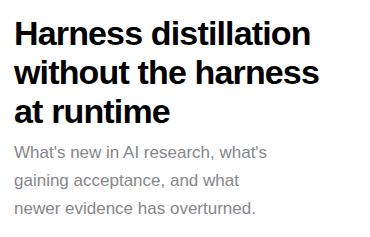 |

Before, the H1 above that dek ran 610/156 in a 632px measure.

| | |
|---|---|
| tablet, before | 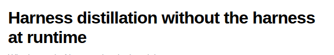 |
| tablet, after | 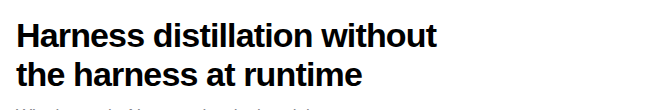 |

## The two cases the earlier run recorded as inert

Both are live defects on the phone, and finding them is why this is a rule
rather than a patch on one viewport. The earlier measurement took the short
title only at the wide viewports, where it is one line and genuinely does not
move.

A 27-character title, which is shorter than anything the press has printed:

| | |
|---|---|
| before, "logs" alone at 67px, 20% of the measure | 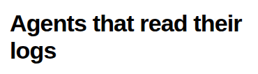 |
| after | 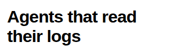 |
| what `balance` would have done, for the record | 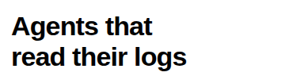 |

A title at the 120-character ceiling `ensure_fresh_title` enforces. The stub is
"on" at 40px, 12% of the measure, which is the worst in the whole range, and
`balance` cannot reach it at all because Chromium stops balancing past its line
cap:

| | |
|---|---|
| before | 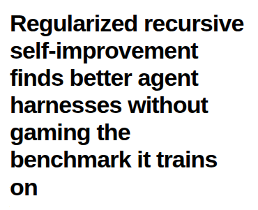 |
| after | 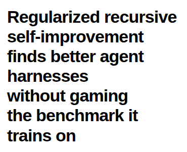 |

## Why the phone does not balance

This is the frame the card was filed on. Both measure defensibly and only one
looks like a mistake.

| | |
|---|---|
| the rag, which is what ships | 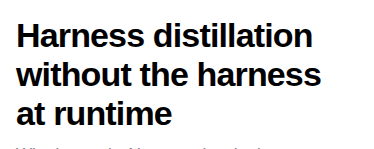 |
| balanced, with the short line in the middle | 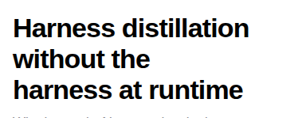 |

## The third block, which closes the set

Ban list 31 is a set that is almost complete reading as a complete one. The set
here is three display blocks and two of them had a rule, so `.statement` was
measured at all three viewports before anything was ruled.

It is centred, which the other two are not, and centred type wants even lines.
It balances correctly today and wants no change. Its plain rendering would end
on a 67px "things." at the phone and a 148px stub at the tablet, so the rule it
already has is doing real work.

| | |
|---|---|
| live, balanced | 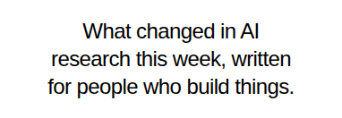 |
| without the rule | 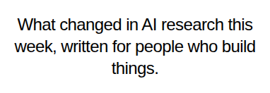 |

## The sweep

33 frames, every page at 390, 820 and 1440. No overflow, no tap target under
44px, nothing clipped. `_audit-before.json` carries the numbers.

- **Scene two** reveals on scroll at all three viewports, 0 to 1, which is the
  owner's 2026-09-19 ruling holding.
- **prefers-reduced-motion** shows every scene-two element at opacity 1 at rest
  at all three viewports. The reduced experience is a designed one.
- **The morph** plays without scrolling the page, at the phone included, which
  is the other half of that ruling. Geometry untouched. Frames in this folder.
- **The h1 left edge across routes at 1440** is 404 on library, issue, graph,
  left-behind, pricing, mission, routines and the 404 page, 364 on skills, 264
  on desk and 478 on home, which is centred by design. That is ban list 29's
  test and the two outliers are board card `eb85b8d1`, already filed. This run
  confirms it is still live and adds the numbers rather than re-filing it.

## Benchmark

`bench.mjs` read the live motion systems off Elicit, Linear and Consensus.

| site | durations | dominant curve |
|---|---|---|
| Elicit | 0.2s | ease-in-out, ease |
| Linear | 0.1s, 0.16s, 0.2s | cubic-bezier(0.25, 0.46, 0.45, 0.94) |
| Consensus | 0.1s | ease |

The finding is that no refinement is owed, and that is worth stating rather
than passing over. `--ease` in our stylesheet is
`cubic-bezier(0.25, 0.46, 0.45, 0.94)`, which is Linear's dominant curve
measured today. `--fast` is 0.1s, which is Consensus's whole site and Linear's
most common clock. `--slow` is 0.16s, which is Linear's dominant duration. The
one value outside the token set is the pill's `0.19s` back-out curve, which is
the owner's Elicit ruling, and Elicit measured 0.2s today, so it is still
right.

A system set a month ago against these references still agrees with them, and
the way to know that is to re-read the references rather than the note that
recorded them. Ban list 25 is the failure this check exists to catch.
